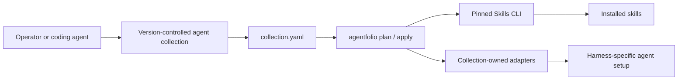

# Agentfolio

Agentfolio safely plans and applies generic external collections. A collection is a version-controlled repository or folder explicitly identified by `collection.yaml`; this CLI repository is never implicitly a collection.

It is designed to be used by coding agents and their operators. A collection is the source of truth for an agent's desired skills, tool catalog, harness setup, and profiles. Agentfolio validates that configuration, previews its effects, and applies it repeatably; it does not run agents or track work.



## What belongs in a collection

- **Skills:** reusable instructions installed through the pinned local Skills CLI.
- **Tool catalog:** a reference inventory of tools and skills available to agents.
- **Harness workflows:** ordered, adapter-owned setup actions.
- **Adapters:** trusted, collection-owned implementations of those actions.
- **Profiles:** named subsets of skills and harnesses for an environment.

A collection tracks **configuration**, not activity. Keep tasks, agent runs, telemetry, and project status in the separate systems that own them.

## Install and start

Requires Node.js 20+.

Install from npm:

```sh
npm install -g @luabagg/agentfolio
```

The same package is also on GitHub Packages. To install from there, add a `.npmrc` with the scope mapping and a token that has `read:packages`:

```sh
@luabagg:registry=https://npm.pkg.github.com
```

The command is `agentfolio` in every case.

To work from source instead:

```sh
npm install
npm link
agentfolio init ./my-collection
cd ./my-collection
agentfolio plan
agentfolio apply --dry-run
agentfolio apply
```

Collection discovery is, in order: `--collection DIRECTORY`, `AGENTFOLIO_COLLECTION`, then the nearest ancestor that physically contains `collection.yaml`.

Skills support uses Agentfolio's pinned local Skills CLI binary. Direct Skills installation is intentionally not documented as a floating network command.

## When to use Agentfolio

Use it when agents or a team need a repeatable, reviewable setup across one or more AI harnesses. Do not use it as an agent runtime, task tracker, or replacement for harness-specific tooling.

## Adapter boundary

```yaml
adapters:
  local:
    executable: node
    args: [./scripts/adapter.mjs]
```

Agentfolio executes this literal argv without a shell; running it trusts collection code. Adapters receive one protocol JSON request on stdin and return one JSON object on stdout. Agentfolio inherits normal process authentication but never discovers, stores, or prints credentials.

`plan` reports selected work. `apply --dry-run` passes a dry-run request to adapters and does not run Skills changes. Collections own all action semantics.

## Commands

```text
agentfolio init [dir]
agentfolio list skills|harnesses|tools|profiles
agentfolio plan [--profile name]
agentfolio apply [--profile name] [--dry-run]
agentfolio doctor [--profile name]
agentfolio verify [--profile name]
```

See [architecture](docs/architecture.md) and [collection schema](docs/collection-schema.md).
